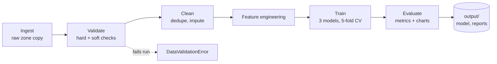

# Healthcare ML Data Pipeline

An end-to-end, tested and containerised data pipeline that turns raw clinical measurements into a validated, evaluated diagnostic model. It supports both **analytics** (data-quality reports, explainability charts) and **machine learning** (model selection, training, scoring), and it fails loudly when the data is bad.

**Dataset:** Wisconsin Diagnostic Breast Cancer (569 patients, 30 tumour measurements from digitised biopsy images, UCI Machine Learning Repository). Built into scikit-learn, so the project runs offline with no downloads.

## The problem this project addresses

There are two connected problems, one clinical and one in engineering.

**1. Clinical: classifying a tumour as malignant or benign is slow and depends on scarce experts.**
Today the diagnosis rests on a specialist reviewing cell samples under a microscope. That takes time, it needs expertise that many clinics lack, and reviewers can disagree on borderline cases. A fast, consistent risk score built from measured cell features can act as a second opinion and help prioritise which cases need attention first. It supports the clinician and does not replace them.

**2. Engineering: most healthcare ML fails because of the data and process around the model, not the model itself.**
Models built in one-off notebooks often use unchecked inputs, leak test data into training, hide manual steps, and cannot be reproduced by anyone else. In healthcare that is dangerous, because a model trained on silently bad data can still look accurate. This project's main contribution is the second one: a reliable, repeatable, tested pipeline that catches bad data before it reaches a model.

## How this compares with common approaches

| Common approach | Typical weakness | What this project does instead |
|---|---|---|
| Manual review only | Slow, inconsistent between reviewers, needs scarce specialists | Gives an instant, consistent risk score as a second opinion |
| One-off Jupyter notebook | Hidden state, not reproducible, hard to test | A modular package with a command-line entry point, fixed random seeds and unit tests |
| Train one model and report accuracy | No comparison, easy to leak test data, accuracy hides missed cancers | Compares three models by cross-validation, splits the data first, and reports recall on malignant cases |
| Black-box model | Clinicians cannot see why a case was flagged | Permutation importance charts, and an interpretable model (logistic regression) won the comparison |
| Silent data errors | Bad data produces a model that looks fine but is wrong | A validation gate stops the run with a clear error before training |
| "Works on my machine" | Results cannot be reproduced elsewhere | Docker image, plus CI that runs lint, tests and the full pipeline on Python 3.10 to 3.12 |

## Technology used and the problem each part reduces

| Tool | Problem it reduces |
|---|---|
| scikit-learn `Pipeline` | Scaling is fitted on training data only, which prevents data leakage |
| Stratified cross-validation | Picks the model without touching the test set, and keeps class ratios stable on a small dataset |
| Permutation importance | Shows which measurements drive predictions, so results can be questioned |
| pandas validation rules | Catches missing labels, negative measurements and excess missing data before training |
| pytest and ruff | Every rule and stage is tested and linted, so changes cannot silently break the pipeline |
| joblib | Saves the whole preprocessing-plus-model object, so scoring new patients uses exactly the same steps as training |
| Docker | The same environment everywhere, so results are repeatable |
| GitHub Actions | Every change is automatically checked on three Python versions |
| matplotlib | Turns results into charts a non-technical reader can check |

Newer tooling would extend this further: workflow schedulers such as Airflow or Prefect to run it on a schedule, MLflow to track experiments and models, and drift monitoring to detect when incoming data stops resembling the training data (see Next steps).

## Results

Held-out test set of 114 patients, never used during training or model selection.

| Metric | Value |
|---|---|
| ROC-AUC | **0.997** |
| Accuracy | 0.974 |
| Precision (malignant) | 0.976 |
| Recall (malignant) | 0.952 |
| F1 (malignant) | 0.964 |

Of 42 malignant cases the model caught 40 and missed 2. It raised 1 false alarm among 72 benign cases. Recall on the malignant class is the headline number here, because a missed cancer costs far more than a false alarm.

<p>
  
  
</p>
<p>
  
</p>
<p>
  
</p>

## Architecture



| Stage | Module | What it does |
|---|---|---|
| Ingest | `pipeline/ingest.py` | Loads the data and lands an unmodified copy in `output/raw/` |
| Validate | `pipeline/validate.py` | Stops the run on missing target, non-binary labels, negative measurements, too many missing values. Warns on duplicates and class imbalance |
| Clean | `pipeline/preprocess.py` | Drops unlabeled rows and duplicates, imputes missing values with the median |
| Features | `pipeline/features.py` | Adds three derived shape features (pure function, no mutation) |
| Train | `pipeline/train.py` | Compares logistic regression, random forest and gradient boosting with stratified 5-fold CV on the training split only |
| Evaluate | `pipeline/evaluate.py` | Test-set metrics, permutation importance, report figures |
| Orchestrate | `pipeline/run_pipeline.py` | Runs all stages, writes the model, metrics, data-quality report and run metadata |
| Serve | `pipeline/predict.py` | Scores new patients from a CSV with the saved model |

## Quick start

```bash
git clone https://github.com/YOUR_USERNAME/healthcare-ml-pipeline.git
cd healthcare-ml-pipeline
make install      # or: pip install -r requirements.txt -r requirements-dev.txt
make test         # 8 tests
make run          # runs the pipeline in about 6 seconds
make predict      # scores 5 sample patients
```

With Docker:

```bash
make docker-build
make docker-run
```

Score your own data (a CSV with the 30 raw measurement columns):

```bash
python -m pipeline.predict --input patients.csv
```

## Outputs

```
output/
  raw/breast_cancer_raw.csv        immutable copy of the source data
  processed/features.csv           cleaned data with engineered features
  models/model.joblib              trained scikit-learn Pipeline (scaler + classifier)
  reports/data_quality.json        validation report
  reports/metrics.json             test metrics, model comparison, run metadata
docs/images/*.png                  charts used in this README
```

## Engineering decisions

- **No leakage.** The train/test split happens first. Model selection uses cross-validation inside the training split. The test set is only touched once, at evaluation.
- **Validation is a gate, not a log line.** Bad data raises `DataValidationError` before any model is trained, and each rule has a unit test.
- **Reproducible.** Fixed random seeds everywhere, pinned minimum dependency versions, a Dockerfile, and CI that runs lint, tests and the full pipeline on Python 3.10, 3.11 and 3.12.
- **Raw data is immutable.** Every run lands the source data untouched before transforming anything, so any stage can be re-run.
- **Swappable dataset.** Only `load_raw()` in `ingest.py` and `TARGET` in `config.py` are dataset-specific.

## Honest limitations

- The dataset is small and clean (no missing values), so cleaning and validation are exercised mainly by the tests rather than by this data.
- The three candidate models are statistically indistinguishable: their cross-validation error bars overlap (see the model comparison chart). Logistic regression won on mean ROC-AUC, and a simpler, more interpretable model that ties the complex ones is a good outcome.
- Permutation importances are small because many features are strongly correlated; shuffling one barely hurts when its neighbours carry the same signal.
- This is a portfolio project on a public teaching dataset. It is not a medical device and must not be used for clinical decisions.

## Next steps

- Orchestrate with Airflow or Prefect and add a scheduled run
- Track experiments and register models with MLflow
- Add drift monitoring on incoming data
- Wrap `predict.py` in a FastAPI service
- Swap in a larger, messier dataset (for example Diabetes 130-US Hospitals readmissions) to stress the cleaning stage

## Project layout

```
healthcare-ml-pipeline/
  pipeline/            package: one module per stage
  tests/               pytest suite
  docs/images/         report figures
  .github/workflows/   CI
  Dockerfile  Makefile  pyproject.toml  pytest.ini
  requirements.txt  requirements-dev.txt
```

## License

MIT
